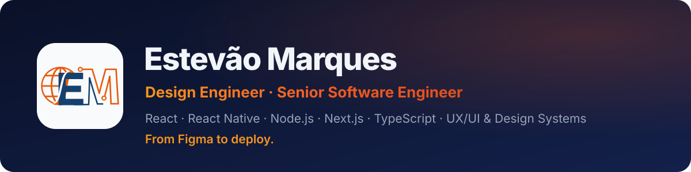

I design digital products in Figma and ship them to production with React, Next.js and TypeScript: design system, admin panel, database and deploy included. 26 years in tech, running my own studio, **EM Soluções Digitais**, since 2015.

Based in Brasília, Brazil. Open to remote, hybrid and on-site roles, and to relocating.

**[Portfolio and case studies](https://emsolucoesdigitais.com.br/en/cases)** · **[LinkedIn](https://www.linkedin.com/in/estevaomarquesux/)** · **[E-mail](mailto:estevao.marques@gmail.com)**

## Selected work

Most of my code belongs to clients, so those repositories are private. Every project below has a case study, the Figma file with variables, components and a clickable prototype, and the live product.

| Project | What I built | Links |
| --- | --- | --- |
| **Condomira** | Website, portals for managers, residents and the front desk, and a CMS admin panel in one product, with a public demo. Logo and identity too. | [Case](https://emsolucoesdigitais.com.br/en/cases/condomira) · [Figma](https://www.figma.com/design/8a1wzs25YMKKGaMWnMnTsX/Condomira-Design) · [Live](https://condomira-site.vercel.app) |
| **LIMPO.AI** | A site where AI reads a photo of the sofa in the customer's own browser and builds the order, plus booking that only offers slots that are really free. | [Case](https://emsolucoesdigitais.com.br/en/cases/limpoai) · [Figma](https://www.figma.com/design/ySNLA0WjpeqxfCUPadzvFT/LIMPO.AI-Design) · [Live](https://limpoaiaguasclaras.com.br/) |
| **Veritas** | An accounting audit firm's website built around the brand symbol, with an admin panel for the team to edit everything. | [Case](https://emsolucoesdigitais.com.br/en/cases/veritas) · [Figma](https://www.figma.com/design/Fy8RQWQ9HPMHwYT84fZbaw/Veritas-Design) · [Live](https://veritas-auditoria.vercel.app) |
| **CM Imóveis** | Real estate portal whose search only shows neighborhoods with listings, plus a custom CRM for the realtor. Logo and identity too. | [Case](https://emsolucoesdigitais.com.br/en/cases/cm-imoveis) · [Figma](https://www.figma.com/design/IarY07Xl09WMWwRZQp4whY/CM-Imoveis-Design) · [Live](https://www.cmimoveisbsb.com.br/) |
| **Fino Trato** | Landing page with before-and-after, online booking and a CRM admin panel, with a brand created from scratch. | [Case](https://emsolucoesdigitais.com.br/en/cases/fino-trato) · [Figma](https://www.figma.com/design/OEqrQaSsibK9sGj9oSAeDY/Fino-Trato-Design) · [Live](https://finotrato-higienizacao.vercel.app/) |
| **CEJB** | Website for a 488-unit condominium, with aerial photos and video and content updated by the management office. Logo and identity too. | [Case](https://emsolucoesdigitais.com.br/en/cases/cejb) · [Figma](https://www.figma.com/design/QUWcF7c324tdAz5zzZ36OE/CEJB-Design) · [Live](https://cejbonline.com.br) |

## Stack

- **Design:** Figma (variables, components with variants, prototypes), UX/UI, design systems, brand identity
- **Front-end:** React, React Native, Next.js, TypeScript, Tailwind CSS, accessibility, performance
- **Back-end:** Node.js, Prisma, PostgreSQL, REST APIs, authentication and permissions
- **AI:** Claude and Codex in my daily workflow, and the Claude API in a WhatsApp customer assistant
- **Deploy:** Vercel, ISR and on-demand revalidation, multilingual sites (PT, EN, ES)

## How I work

- **One person from the first wireframe to production.** The design tokens in Figma are the same ones in the code.
- **Accessible and fast by default.** My own site scores 100 in Lighthouse accessibility.
- **Admin panels the client actually uses.** Content, pricing, schedules and leads are edited without calling a developer.
